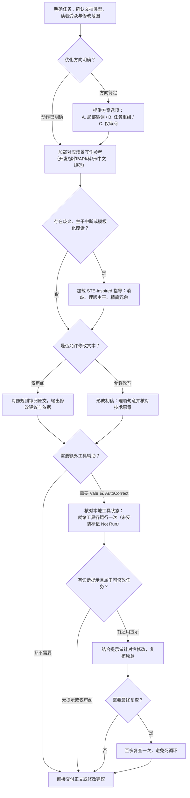

# TextPrison / 文字狱

用于规范和改善中英文技术文档的 Agent Skill。在保留技术原意的前提下精简表达、消除歧义，并可按需调用 Vale 与 AutoCorrect 进行格式检查。

支持 README、操作指南、API 手册、产品帮助、科研摘要及 Agent 指令；也支持在对话中直接润色技术解答。日常使用无需额外依赖，纯文字指导开箱即用。

- [快速上手](#快速上手)
- [在 Agent 中使用](#在-agent-中使用)
- [工作流程](#工作流程)
- [格式与排版检查工具](#格式与排版检查工具)
  - [Vale：显式写作规则检查](#vale显式写作规则检查)
  - [AutoCorrect：可选中文排版建议](#autocorrect可选中文排版建议)
- [STE 写作原则](#ste-写作原则)
- [仓库目录](#仓库目录)
- [相关文档与边界声明](#相关文档与边界声明)

---

## 快速上手

### 1. 使用 npx 安装（推荐）

需本地安装有 Node.js/npm。直接使用 [Vercel Skills CLI](https://github.com/vercel-labs/skills) 安装：

```bash
# 仅安装到当前项目
npx skills add psiQAQ/text-prison

# 安装到全局（所有项目通用）
npx skills add psiQAQ/text-prison --global
```

*注：若目标目录已有同名 Skill，npx 可能会直接覆盖，建议提前备份。*

### 2. 本地仓库安装（Python 标准库）

如果你已克隆本仓库，可直接运行安装脚本（不会覆盖已有目录）：

```bash
# 查看支持的宿主（Codex, Claude Code, Pi 等）
python tools/install_skill.py --help
```

详细路径与参数参见 [安装说明](docs/INSTALL.md)。Skill 规则源文件位于 [skills/text-prison](skills/text-prison/SKILL.md)。

---

## 在 Agent 中使用

安装后，向 Agent 说明目标读者、文档类型与修改范围即可。例如在 **Codex** 中：

> $text-prison 请优化本项目的 README，面向首次安装的用户。保留所有技术事实、命令和链接。先给出具体改动方案；若需要工具检查，请说明工具与范围。

对于允许调整结构的文档，Agent 通常提供以下方向：

| 选项 | 适用场景 | 说明 |
|---|---|---|
| **A. 局部清晰化** | 结构已定，只想改通顺 | 保留现有章节与标题，澄清指代、前提条件与术语。 |
| **B. 按读者任务重组**（常用） | 结构混乱或面向新用户 | 调整逻辑顺序（如：前提 → 安装 → 快速上手 → 排错）。需复核锚点链接。 |
| **C. 仅审阅** | 只提意见，不改代码/文件 | 逐项列出可读性问题、依据与改写建议。 |

若指令已明确（例如“把这段改通顺，保留参数名”），Agent 会直接执行改写，无需多轮确认。

你也可以在对话中直接请求解释技术问题：

> $text-prison 请解释“统计不显著”与“证明相等”的区别。面向有统计基础的读者，保留前提和不确定性，直接在对话中回答。

---

## 工作流程

Skill 遵循“按需加载参考、单轮集中修订、工具非强求”原则：



---

## 格式与排版检查工具

所有格式与排版工具均为**可选依赖**。未安装工具不影响文字优化；环境缺失时 Agent 会在报告中标记为 `Not Run`，不会私自联网下载。

### Vale：显式写作规则检查

[Vale CLI](https://github.com/vale-cli/vale) 是一个开源的文档语法/风格检查器。TextPrison 为其编写了中文与英文规则（位于 `skills/text-prison/vale/`），用于检查死链、泛指链接文字（如“点击这里”）以及可选的模板套话。

#### 实测示例

以包含泛指链接、多余标点和代码块的文件 `vale-example.md` 为例：

````markdown
# Setup.

See [here](https://example.com).

请[点击这里](https://example.com)。

Click the button!  Wait.

```md
# Setup.
[here](https://example.com) [点击这里](https://example.com)
Click the button!  Wait.
```

> [here](https://example.com) [点击这里](https://example.com)
````

使用对应用途的规则检查该文件：

```powershell
# 以中文规则为例
vale --config ./skills/text-prison/vale/zh.ini --output=JSON ./vale-example.md
```

**检查结果摘要（实测退出码均为 0）：**

| 配置与用途 | 触发提示 | 说明 |
|---|---|---|
| `zh.ini`（中文） | 1 条 | 第 5 行：提示“点击这里”未说明目标。代码块与引用块受作用域保护，未报错。 |
| `dev-en.ini`（英文开发） | 4 条 | 标题末尾句号、泛指链接 `here`、感叹号、多余空格。 |
| `product-en.ini`（产品帮助） | 4 条 | 提示将输入专有动词 `Click` 替换为中性动词 `Select` 等。 |
| `conservative.ini`（中英混合） | 2 条 | 同时报告中英文泛指链接。 |

完整规则说明见 [Vale 维护文档](skills/text-prison/vale/README.md)。

---

### AutoCorrect：可选中文排版建议

[AutoCorrect](https://github.com/huacnlee/autocorrect) 用于纠正中英文混排时的空格与标点规范。TextPrison 提供了保守配置（`skills/text-prison/autocorrect/conservative.yml`），仅建议在中文字符与西文/数字间添加必要空格，并默认跳过代码块。

#### 实测示例

针对输入文件：

````markdown
请使用Python处理数据。

```python
message = "中文Python"
```

保留`中文Python`示例。
````

运行检查命令：

```powershell
autocorrect --lint --format json --config ./skills/text-prison/autocorrect/conservative.yml ./sample.md
```

**工具返回：**
- 第一行建议修改为：`请使用 Python 处理数据。`
- 围栏代码与行内代码均受保护，未产生误报。

详细用法见 [AutoCorrect 说明](skills/text-prison/autocorrect/README.md)。

---

## STE 写作原则

TextPrison 借鉴了 [ASD-STE100](https://www.asd-ste100.org/about_STE.html)（简化技术英语）的消歧思想，提炼出一套跨语种的技术写作原则：

1. **统一术语**：同一概念在全文中使用完全相同的名称，不刻意换词。
2. **前置条件**：在动作发生前说明前提（“若...则执行...”，避免把关键前提放在句尾）。
3. **消除代词歧义**：避免使用指代不明的“它/该系统/此操作”，明确写出具体对象。
4. **精简套话与铺垫**：删去冗余的修饰词和模板化开头，直接陈述技术事实。
5. **区分状态与动作**：清晰区分系统当前所处的状态、用户需要执行的操作以及操作带来的预期结果。

> 示例：
> - **改写前**：完成导出后，如果还要修改，可以再打开它。
> - **改写后**：导出完成后，如需修改配置，用编辑器打开导出的配置文件。

详细写作指导见 [STE-inspired 参考](skills/text-prison/references/ste-inspired.md)。

---

## 仓库目录

```text
text-prison/
├── README.md                            # 项目主文档（本文档）
├── AGENTS.md                            # Agent 执行规则与维护约束
├── NOTICE.md                            # 第三方许可与声明
├── sources.json                         # 文献与参考资料索引
├── docs/                                # 说明与设计文档
│   ├── INSTALL.md                       # 安装与宿主环境配置
│   ├── USAGE.md                         # 场景使用指南与调用说明
│   ├── DESIGN.md                        # 系统架构与设计边界
│   ├── RELATED_WORK.md                  # 相关工作与研究背景
│   ├── research/                        # 可读性与语言学研究资料
│   └── plans/                           # 设计方案与历史交付记录
├── skills/                              # Skill 核心源文件
│   └── text-prison/
│       ├── SKILL.md                     # Agent 调度入口与提示词
│       ├── agents/                      # 针对不同宿主（Codex等）的配置
│       ├── references/                  # 按场景分发的写作规则
│       ├── vale/                        # Vale 规则与配置文件
│       └── autocorrect/                 # AutoCorrect 排版配置
├── tools/
│   └── install_skill.py                 # 本地安装辅助脚本（Python）
└── submodules/                          # 只读上游研究快照（不参与安装）
```

---

## 相关文档与边界声明

- **配置指南**：[安装配置说明](docs/INSTALL.md) ｜ [使用指南与示例](docs/USAGE.md)
- **底层规则**：[Vale 规则库](skills/text-prison/vale/README.md) ｜ [AutoCorrect 配置](skills/text-prison/autocorrect/README.md)
- **学术与参考**：[可读性研究报告](docs/research/2026-10-26-llm-readability/READABILITY_RESEARCH_2026-10-26.md) ｜ [第三方许可与边界](NOTICE.md)

### 边界声明

1. **非强制性认证**：借鉴 STE 规范并不等同于完整的 ASD-STE100 官方认证；格式检查不能代替人工技术复核。
2. **保护技术原意**：改写时严禁擅自修改专有名词、API 标识符、代码逻辑、权限条件和计量单位。
3. **环境隔离**：未安装的检查工具绝不自动联网静默安装；上游子模块快照为只读参考，不执行其中的脚本或测试。
