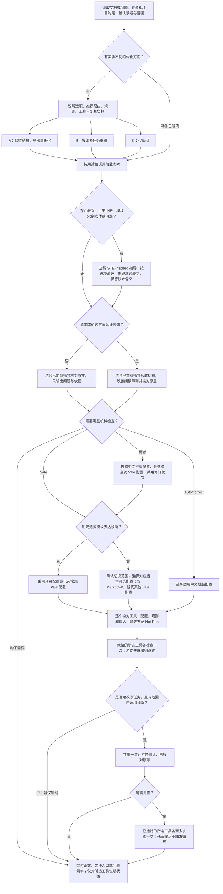

# TextPrison / 文字狱

一个中英文写作 Skill，按内容用途选用规则，在保留技术含义的前提下改善表达，并按需调用 Vale 和 AutoCorrect 检查。

适用于 README、安装与操作说明、API 参考、产品帮助、科研摘要和 Agent 指令，也可处理你明确要求使用 TextPrison 的技术回答。你指定读者、内容和允许的改动，Agent 再选择需要的写作参考；只使用文字指导时，无需额外工具。

- [安装](#安装)
- [在 Agent 中使用](#在-agent-中使用)
- [Vale：显式写作规则检查](#vale显式写作规则检查)
- [AutoCorrect：可选中文排版建议](#autocorrect可选中文排版建议)
- [STE 思想如何参与写作](#ste-思想如何参与写作)
- [仓库目录](#仓库目录)
- [详细资料与使用边界](#详细资料与使用边界)

## 安装

从 GitHub 安装需要已有 Node.js/npm，并满足 [Vercel Skills CLI](https://github.com/vercel-labs/skills) 的当前要求。选一种范围执行即可：

**只在当前项目使用**：先进入目标项目根目录，再运行：

```bash
npx skills add psiQAQ/text-prison
```

**在当前用户的多个项目使用**：

```bash
npx skills add psiQAQ/text-prison --global
```

npx 可能先询问是否下载 `skills` 包；随后按 CLI 当前提示选择宿主和安装方式。已有同名 Skill 时先核对并保全，安装可能覆盖旧内容。安装完成后核对实际位置，再在宿主中调用。

| 你需要什么 | 安装途径 |
|---|---|
| 从 GitHub 安装到项目或全局 | 上面的 npx 命令 |
| 已有本地仓库，希望使用 Python 标准库安装 | 项目安装器，支持 Codex、Claude Code、Pi 和 Codex + Claude Code，拒绝覆盖已有目标 |
| 只改善文字表达 | 安装 Skill 即可 |
| 需要显式风格或链接诊断 | 另行准备 Vale，按用途选择规则 |
| 需要中文与西文间距建议 | 另行准备可选的 AutoCorrect |

两种安装途径都只安装 Skill，不同时安装检查工具。宿主路径、Python 命令、已有副本更新和工具准备步骤见[安装说明](docs/INSTALL.md)；写作规则的唯一源目录为 [skills/text-prison](skills/text-prison/SKILL.md)。

## 在 Agent 中使用

安装后，指定要处理的文档、读者和修改范围。例如在 **Codex** 对话中输入：

> $text-prison 请优化本项目 README，面向首次安装的用户。保留事实、命令和链接目标。先给出有实质差异的方案；如需工具检查，请说明工具及覆盖范围。

这是按当前 [Skill](skills/text-prison/SKILL.md) 编写的**示意交互，不是实际 Agent 运行记录**。Claude Code、Pi 的调用语法见[宿主调用表](docs/INSTALL.md#从本地仓库安装python)。

对于这类允许调整组织方式的请求，Agent 可以给出以下选择：

| 选项 | 改动与规则 | 工具选择和复核负担 |
|---|---|---|
| A．局部清晰化 | 保留章节和标题，按用途及语言澄清对象、条件和术语 | 需要链接或风格诊断时选 Vale；选择中文排版时再加 AutoCorrect。你复核句意是否保留 |
| B．按安装与使用重组（本例推荐） | 将已有前提、安装、首个用例及故障处理按读者任务排序 | 工具仍按需选择，不因重组自动全开。你还需复核步骤先后和标题锚点 |
| C．仅审阅 | 输出问题、依据与建议，不改文件 | 所选工具各检查原文至多一次，你决定后续是否修改 |

选项随任务变化，不是固定菜单。已经要求“只改术语”“保留标题把这一段改通顺”等明确动作时，Agent 直接在范围内处理；请求本身是审阅时，也无需先选择 C。

技术回答也可以直接在对话中交付。例如：

> $text-prison 请解释“统计不显著”与“证明相等”的区别。面向有基础统计知识的读者，保留前提和不确定性，直接在对话中回答。

这同样是**示意调用**。回答沿用解释或科研等现有用途，默认只使用文字指导，不为检查创建文件；未请求、未使用工具时不附机械状态清单。文档任务保留自动发现，普通聊天和未指定使用 TextPrison 的技术问答不进入此流程。



[STE-inspired 指导](skills/text-prison/references/ste-inspired.md) 在改写或审阅前按需加载：其中的 STE 启发原则帮助澄清术语、对象、指代和条件，后续可读性指导处理主干中断、模板表达和重复铺垫。仅审阅时只指出问题；允许改写时才调整文字。即使不运行 Vale 或 AutoCorrect，这些写作原则仍可使用。完整介绍见 [STE 思想如何参与写作](#ste-思想如何参与写作)。

工具提示只影响已获准修改的内容。缺少工具时说明 `Not Run`，不自动下载；同一轮两个工具最多各运行一次，共用一次修订，必要时至多再各复查一次。自动发现取决于宿主；上图说明 Skill 的约定流程，不证明宿主触发或写作效果已通过实测。更多局部修改与科研保护示例见[使用说明](docs/USAGE.md)。

## Vale：显式写作规则检查

**原项目：[Vale CLI](https://github.com/vale-cli/vale)。** Vale 先解析 Markdown 等文档结构，再按配置中的规则检查对应作用域，返回位置、规则名、级别和提示。常规配置只启用少量 Google/Microsoft 建议和原创模糊链接规则；明确选择模板表达诊断时，还可用独立的可选配置提示少量中英文固定短语。当前配置不全量检查语法，也不自带完整项目术语库。

在 TextPrison 中，它的过程是：**选文档用途 → 读取项目已有配置或选定的 Skill 配置 → 确认 CLI 与所需规则已准备 → 检查明确输入 → Agent 判断提示是否符合原意和修改范围 → 按需修订**。Google/Microsoft 包须事先按授权准备；中文、科研和保守配置不需要它们。完整配置与维护版本见 [Vale 说明](skills/text-prison/vale/README.md)。

可选模板配置也不需要下载规则包，仅用于 Markdown，并替代当轮其他 Vale 配置，不额外扫描。它只定位字符串，不能判断一句话是否空泛或由 AI 生成；必要背景、真实对比、原样引语和科研限定仍须保留。仅请求一般润色或检查时不自动选用，六个原有配置的行为不变。

需要这类提示时，可明确提出：“请检查这份中文 Markdown 的模板表达，使用 TextPrison 的可选中文 Vale 配置，仅报告候选位置，不改文件。”这是示意请求，仍需先确认本机已有 Vale；配置与固定短语清单见 [Vale 维护入口](skills/text-prison/vale/README.md#规则含义和边界)。它不增加新引擎，也不将机械提示作为内容正确性验收。

### 实际案例：同一输入，按用途选择检查范围

以下为 **2026-10-25 实际运行的演示材料**，实测 Vale **3.25.1**、Google **v0.7.1**、Microsoft **v0.15.1**。这组版本标识案例来源，当前维护范围以 Vale 说明为准。案例复用已保存的 CLI 记录；本次 README 整理没有重新运行六套检查。

输入含正文、围栏代码和引用块。需要复现时，将下面内容保存为 `vale-example.md`，保留空行和双空格：

````markdown
# Setup.

See [here](https://example.com).

请[点击这里](https://example.com)。

Click the button!  Wait.

```md
# Setup.
[here](https://example.com) [点击这里](https://example.com)
Click the button!  Wait.
```

> [here](https://example.com) [点击这里](https://example.com)
````

下列复现命令使用 **PowerShell 7**，在示例文件所在目录执行；先将 `$skillRoot` 替换为实际已准备规则的安装目录。路径是公开占位值，历史运行使用的是已安装副本。日常写作只选适用的一套配置，不轮流执行全部配置。

```powershell
$skillRoot = 'D:/path/to/installed/text-prison'
$configPath = Join-Path $skillRoot 'vale/dev-en.ini'
$samplePath = (Resolve-Path -LiteralPath './vale-example.md' -ErrorAction Stop).Path
if (-not (Test-Path -LiteralPath $configPath -PathType Leaf)) {
    throw "配置不存在：$configPath"
}
$sample = Get-Content -LiteralPath $samplePath -Raw -Encoding utf8 -ErrorAction Stop
$previousOutputEncoding = $OutputEncoding
try {
    $OutputEncoding = [System.Text.UTF8Encoding]::new($false)
    $sample | vale --config $configPath --no-global --output=JSON --ext=.md
    $valeExitCode = $LASTEXITCODE
}
finally {
    $OutputEncoding = $previousOutputEncoding
}
$valeExitCode
```

已保存的六次运行均以该 Markdown 作为 stdin，输出对象名为 `stdin.md`。替换命令中的配置文件名，可复现对应用途；下表是实际结果摘要，不是质量评分：

| 文档用途 / 配置 | 本例实际提示 | 条数 / 退出码 |
|---|---|---|
| 英文开发 / `dev-en.ini` | 英文模糊链接、标题句号、感叹号、双空格 | 4 / 0 |
| 英文操作 / `procedure-en.ini` | 与英文开发相同 | 4 / 0 |
| 英文产品帮助 / `product-en.ini` | 英文模糊链接、标题标点、UI 动词、双空格 | 4 / 0 |
| 英文科研 / `research-en.ini` | 英文模糊链接 | 1 / 0 |
| 中文 / `zh.ini` | 中文模糊链接 | 1 / 0 |
| 中英混合、Agent 指令 / `conservative.ini` | 中英文模糊链接 | 2 / 0 |

操作配置与开发配置的机械规则目前相同；单独保留操作入口不表示运行了额外 STE 合规检查。以下直接摘录实际 JSON 的 `Check`、`Line`、`Message`，所列级别均为 `suggestion`：

| 规则 | 行 | 原始提示 |
|---|---|---|
| `Google.HeadingPunctuation` | 1 | Don't put a period at the end of a heading. |
| `TextPrison.VagueLinkEn` | 3 | Replace the generic link text 'here' with a description of its destination, if the source supports one. |
| `Google.Exclamation` | 7 | Don't use exclamation points in text. |
| `Google.Spacing` | 7 | 'n!  W' should have one space. |
| `Microsoft.HeadingPunctuation` | 1 | Don't use end punctuation in headings. |
| `Microsoft.UIVerbs` | 7 | Use 'select' instead of the input-specific verb 'Click'. |
| `Microsoft.Spacing` | 7 | 'n!  W' should have one space. |
| `TextPrison.VagueLinkZh` | 5 | 链接文字“点击这里”没有说明目标；有来源依据时改用具体名称，保留链接地址。 |

<details>
<summary>查看中文配置的实际 JSON 输出</summary>

```json
{
  "stdin.md": [
    {
      "Action": {
        "Name": "",
        "Params": null
      },
      "Suggestions": [],
      "Span": [
        3,
        6
      ],
      "Check": "TextPrison.VagueLinkZh",
      "Description": "",
      "Link": "",
      "Message": "链接文字“点击这里”没有说明目标；有来源依据时改用具体名称，保留链接地址。",
      "Severity": "suggestion",
      "Match": "点击这里",
      "Line": 5
    }
  ]
}
```

退出码为 `0`，仍有一条建议。其他配置的原始输出具有相同的位置、规则和消息字段。

</details>

这些提示如何影响编辑，仍取决于任务：允许改标题时才考虑去掉 `Setup.` 的句号，并核对锚点；输入设备无关的产品帮助可考虑将 `Click` 改为 `Select`；需要强调鼠标操作时可保留。`here` 和“点击这里”应在有目标页面依据后改成具体名称，本例的示意 URL 不足以支持编造名称。以上是**修改候选，不是工具自动改写的结果**。

本配置下，围栏代码及引用块中的相同文字没有被报告：代码由 Markdown 解析及跳过作用域保护，引用块还显式加入了 `SkippedScopes`。这不表示任意引号、公式或文件格式都受到相同保护。Vale 的退出码 `0` 也可以包含建议，必须结合输出判断。

## AutoCorrect：可选中文排版建议

**原项目：[AutoCorrect](https://github.com/huacnlee/autocorrect)。** 它按文件类型识别可处理文本，再用排版规则产生间距、标点等诊断。TextPrison 当前只选用中西文/数字间距建议，其他已知规则与围栏代码处理均关闭；它不判断一般中文语法或科学含义。

使用过程是：**确认需要中文排版建议 → 读取项目已有配置或选定的保守配置 → 验证工具、文件与可编辑正文 → 以 lint 模式取得建议 → Agent 按项目惯例和授权范围决定是否修改**。默认不使用 `--fix`；缺少它不妨碍文字指导或 Vale。配置、维护版本和输入限制见 [AutoCorrect 说明](skills/text-prison/autocorrect/README.md)。

### 实际案例：正文间距与代码保护

以下为 **2026-10-25、AutoCorrect 2.16.3 的实际运行记录**，使用随 Skill 分发的 `autocorrect/conservative.yml`。同样复用既有记录，不表示本次重新执行。

当时的 `installation-check.md` 完整内容：

````markdown
请使用Python处理数据。

```python
message = "中文Python"
```

保留`中文Python`示例。
````

在保存该文件的目录，沿用前例设置的 `$skillRoot`，确认工具已准备后可用以下 PowerShell 命令复现；命令路径已改为公开占位变量：

```powershell
$autoCorrectConfig = Join-Path $skillRoot 'autocorrect/conservative.yml'
$documentPath = (Resolve-Path -LiteralPath './installation-check.md' -ErrorAction Stop).Path
foreach ($inputPath in @($autoCorrectConfig, $documentPath)) {
    if (-not (Test-Path -LiteralPath $inputPath -PathType Leaf)) {
        throw "文件不存在：$inputPath"
    }
    Get-Content -LiteralPath $inputPath -Raw -ErrorAction Stop | Out-Null
}
autocorrect --lint --format json --config $autoCorrectConfig $documentPath
$autoCorrectExitCode = $LASTEXITCODE
$autoCorrectExitCode
```

实际退出码为 `0`，stdout 如下，仅调整缩进便于阅读：

```json
{
  "count": 1,
  "messages": [
    {
      "filepath": "installation-check.md",
      "lines": [
        {
          "l": 1,
          "c": 1,
          "new": "请使用 Python 处理数据。",
          "old": "请使用Python处理数据。",
          "severity": 2
        }
      ],
      "error": ""
    }
  ]
}
```

工具建议将第一行改为“请使用 Python 处理数据。”，`severity: 2` 表示 warning。若用户选择了排版调整且项目惯例一致，Agent 可以采纳；lint 本身未改写文件。围栏代码和行内代码均未产生提示，这是该版本与本配置的实际结果，不延伸为对所有引文、元数据或公式的保护承诺。

### 实际案例：纯散文 stdin 与无建议输入

同一配置也实际检查过两条纯散文：

| 输入 | 实际结果 | 退出码 |
|---|---|---|
| `请使用Python处理数据。` | 一条间距建议，`filepath` 为 `<STDIN>` | 0 |
| `请使用 Python 处理数据。` | 无建议，输出如下 | 0 |

```json
{"count": 0,"messages": []}
```

在 PowerShell 7 中，沿用并核对 `$autoCorrectConfig` 后可复现无建议输入：

```powershell
$previousOutputEncoding = $OutputEncoding
try {
    $OutputEncoding = [System.Text.UTF8Encoding]::new($false)
    '请使用 Python 处理数据。' | autocorrect --lint --format json --config $autoCorrectConfig --stdin
    $autoCorrectExitCode = $LASTEXITCODE
}
finally {
    $OutputEncoding = $previousOutputEncoding
}
$autoCorrectExitCode
```

将输入替换为表中第一行即可复现有建议的纯散文。**不要把含代码的 Markdown 改走 stdin**：本案例版本的 stdin 按纯文本处理，文件输入才采用相应格式。`count` 是文件结果数，不是提示总数；有建议和无建议都可能退出 `0`。

另一次故障核对中，故意把目录作为配置路径，程序报告读取错误并退出 `101`；一个内容为 `rules: [` 的损坏 YAML 片段却退出 `0`。因此正常使用先验证配置存在、可读及内容有效，再结合 `messages`、`error`、stderr 和实际覆盖范围判断，不能把退出码当作配置或语义正确的证明。完整处理约定见[调用说明](skills/text-prison/references/autocorrect.md)。

## STE 思想如何参与写作

### ASD-STE100 是什么

[ASD-STE100 Simplified Technical English](https://www.asd-ste100.org/about_STE.html)（STE，简化技术英语）是面向英文技术文档的受控语言标准，最初用于航空维修文档，帮助读者准确理解操作说明，尤其照顾母语并非英语的读者。它通过限制容易产生歧义的表达、统一用词和句子结构，降低技术说明被误读的可能。

标准由两部分组成：**写作规则**约束语法、句子结构和表达方式；**受控词典**规定获准词语的用法，通常为一个词限定一个含义和一种词性。标准也允许按规则使用行业、公司或项目的技术名词和动词，不要求把专业术语全部换成日常词。官方介绍和 [FAQ](https://www.asd-ste100.org/STE_faq.html)说明了它的用途、术语处理及适用范围。

### 在 TextPrison 中如何使用

TextPrison 根据这些官方说明和固定社区参考，提炼可跨语言使用的消歧方法：同一概念保持名称一致，明确对象与指代，在动作前给出必要条件，区分操作、解释和结果，并保持步骤及段落主题清楚。

这些方法通过 Agent 写作指导生效。README、操作说明、API 参考、科研说明或 Agent 指令中出现相关歧义、主干中断、模板冗余或体裁问题时，Skill 按需加载 [STE-inspired 参考](skills/text-prison/references/ste-inspired.md)。不会为每份文档强制套用英文词数、时态或受控词典，也不会因此运行额外工具。

参考页也吸收了[可读性研究](docs/research/2026-10-26-llm-readability/READABILITY_RESEARCH_2026-10-26.md)中的工程建议：不以最少字数或 Token 为目标；必要时展开名词串、已有关系和插入信息。模板表达按实际作用处理，不为保留原文风格留下阅读障碍，也不因“像 AI”改动清楚的表达。原文事实、技术含义及用户指定的语气继续保留。这些补充不是新的 STE 标准条款，也不证明本 Skill 已改善读者表现。

**编辑示例，非运行记录**：假设上下文已明确“它”是导出的配置文件，且使用编辑器修改该文件。

> 原文：完成导出后，如果还要修改，可以再打开它。
>
> 调整：导出完成后，如需修改配置，用编辑器打开导出的配置文件。

这里澄清对象和条件；真实材料缺少这些信息时，Agent 会指出缺口。科研限定、API 标识符和权限条件仍按原意保留。完整原则、英文及科研示例和来源边界见参考；这不是完整标准实现或认证。

## 仓库目录

以下列出公开文件和固定子模块入口；`skills/` 完整展开。私有运行记录、本地下载论文、Git 内部文件和按需同步的规则包不在树中。

```text
text-prison/                              # 仓库根目录
├── .gitattributes                       # Git 文件属性与换行约定
├── .gitignore                           # 本地记录和生成文件的忽略规则
├── .gitmodules                          # 五个只读上游快照的来源
├── AGENTS.md                            # 项目执行范围与保全约定
├── README.md                            # 安装、调用、工具案例与仓库导览
├── DOCS_PATCH.md                         # 原始文档补丁说明，按历史输入保留
├── MANIFEST.sha256.json                  # 原始包的历史文件清单，不代表当前版本
├── NOTICE.md                            # 第三方来源与许可边界
├── sources.json                         # 历史书目与当前参考的机器可读索引
├── docs/                                # 使用、安装、设计与来源说明
│   ├── INSTALL.md                       # 安装范围、宿主路径、工具准备及更新
│   ├── USAGE.md                         # 编辑范围、检查调用和状态处理
│   ├── DESIGN.md                        # 当前职责、流程与设计边界
│   ├── RELATED_WORK.md                  # 来源目录与上游快照阅读范围
│   ├── research/                        # 调研文档与独立来源登记
│   │   ├── 2026-10-26-llm-readability/   # 可读性报告、文献地图、精读与原包凭证
│   │   └── 2026-10-26-linguistic-naturalness/ # 自然度与表达特征的原始研究包
│   └── plans/                           # 已审阅的方案与交付记录
│       ├── text-prison-vale.md           # 统一 Skill 与 Vale 接入方案
│       ├── chinese-publish-install.md   # 中文支持、发布、安装和 CLI 实测记录
│       ├── readme-user-guide-ste.md      # README 与 STE 方案、意见取舍及验收
│       ├── 2026-10-26-readability-evolution.md # 可读性 P0＋P1 范围及实施记录
│       └── 2026-10-26-linguistic-naturalness-candidates.md # 原始候选方案，非当前实施清单
├── skills/                              # 可安装 Skill 的唯一源码位置
│   └── text-prison/                     # 自包含的 TextPrison Skill
│       ├── SKILL.md                     # 发现描述、方案选择、编辑与检查流程
│       ├── agents/                      # 宿主发现与展示配置
│       │   └── openai.yaml              # Codex 展示信息与隐式调用策略
│       ├── references/                  # 按用途、语言或工具加载的参考
│       │   ├── index.md                 # 参考选择入口
│       │   ├── explanation.md           # 概念解释、README 概览与教程
│       │   ├── procedure.md             # 安装、操作与故障处理
│       │   ├── reference.md             # API、参数和查询手册
│       │   ├── research.md              # 科研论证、限定条件与证据强度
│       │   ├── agent-spec.md            # Agent 目标、权限与停止条件
│       │   ├── lang-zh.md               # 中文表达与技术内容保护
│       │   ├── lang-en.md               # 英文表达与技术内容保护
│       │   ├── google.md                # 开发文档写作摘要
│       │   ├── microsoft.md             # 英文产品帮助与 UI 表述摘要
│       │   ├── microsoft-zh.md          # 简体中文本地化摘要
│       │   ├── chinese-typography.md    # 可选中文排版约定与科研例外
│       │   ├── ste-inspired.md          # 跨用途的术语、指代、条件与结构消歧
│       │   ├── vale.md                  # Vale 的前置核对、输入与诊断处理
│       │   └── autocorrect.md           # AutoCorrect 的输入保护与建议处理
│       ├── vale/                        # Vale 配置与原创规则
│       │   ├── README.md                # Vale 维护版本、规则和包来源的唯一入口
│       │   ├── dev-en.ini               # 英文开发文档配置
│       │   ├── procedure-en.ini         # 英文操作说明配置
│       │   ├── product-en.ini           # 英文产品帮助配置
│       │   ├── research-en.ini          # 英文科研链接文字配置
│       │   ├── zh.ini                   # 中文链接文字配置
│       │   ├── conservative.ini         # 中英混合与 Agent 指令的保守配置
│       │   ├── optional-prose-zh.ini     # 明确选择的中文模板表达提示
│       │   ├── optional-prose-en.ini     # 明确选择的英文模板表达提示
│       │   └── styles/                  # 原创规则及获准同步包的目标位置
│       │       ├── .gitignore           # 仅忽略指定同步包和 Vale 生成目录
│       │       ├── TextPrisonOptional/  # 独立选用的三条固定短语规则
│       │       │   ├── BoilerplateOpeningZh.yml # 中文模板铺垫
│       │       │   ├── BoilerplateEndingZh.yml  # 中文固定套尾
│       │       │   └── OverloadedIntroEn.yml   # 英文冗长前缀
│       │       └── TextPrison/          # 本项目的原创链接文字规则
│       │           ├── VagueLinkEn.yml  # 英文泛指链接文字提示
│       │           └── VagueLinkZh.yml  # 中文泛指链接文字提示
│       └── autocorrect/                 # 可选中文排版配置
│           ├── README.md                # AutoCorrect 版本、规则和输入边界的唯一入口
│           └── conservative.yml         # 仅建议中西文/数字间距的配置
├── tools/                               # 本地安装工具
│   └── install_skill.py                 # Python 标准库项目安装器，拒绝覆盖
└── submodules/                          # 固定、只读的研究快照，不属于安装包
    ├── asd-ste100-skill/                 # 社区 STE Skill 的设计参考
    ├── SimpleEnglish/                   # 简化英语与文档处理设计参考
    ├── ste/                             # STE 工具实现的研究参考
    ├── ste-prompt/                      # STE 提示与按需指令设计参考
    └── vale/                            # stuffbucket 的独立 STE 项目，非上文 Vale CLI
```

## 详细资料与使用边界

- [安装说明](docs/INSTALL.md)：宿主路径、工具准备和已有副本更新。
- [使用说明](docs/USAGE.md)：局部修改、科研保护、CLI 调用与失败处理。
- [当前设计](docs/DESIGN.md)、[README 与 STE 实施记录](docs/plans/readme-user-guide-ste.md)：职责、此前审阅取舍及验收。
- [可读性调研](docs/research/2026-10-26-llm-readability/READABILITY_RESEARCH_2026-10-26.md)、[P0＋P1 实施记录](docs/plans/2026-10-26-readability-evolution.md)：研究依据、技术回答入口及本地文献获取情况。
- [17 篇分主题精读](docs/research/2026-10-26-llm-readability/07-thematic-fulltext-review.md)：下载版本的全文证据、局限和应用建议。
- [自然度与表达特征研究包](docs/research/2026-10-26-linguistic-naturalness/README.md)：保留基于旧版本的候选材料；其中的演进建议不是当前实施清单，已采用的能力以本 README 和 Skill 说明为准。
- [来源目录](docs/RELATED_WORK.md)、[机器索引](sources.json)、[归属说明](NOTICE.md)：来源、阅读范围与许可。
- [统一 Skill 方案](docs/plans/text-prison-vale.md)、[中文支持及安装记录](docs/plans/chinese-publish-install.md)：此前设计与实际交付。

保留事实、条件、权限、数字、单位、引用和不确定性。规则借鉴不等于完整 ASD-STE100 认证，也不证明语义正确。代码、命令、标识符和原样引文按用户要求保护，不为文风统一擅自修改。

五个上游子模块保持固定版本，仅作只读参考，不安装、不执行。原始 ZIP、根 `MANIFEST.sha256.json` 与 `DOCS_PATCH.md` 保留原包的历史含义，不代表当前功能或验证状态。

本仓库不再运行或维护 Agent 实战、模型评委、A/B 实验、测试套件或评审网页。原提交和归档标签保留在 Git 历史中；已删除的忽略目录原始数据没有另行备份。

不做观点审查，不以规避 AI 文本检测为目标，不自动安装工具或修改全局指令。
