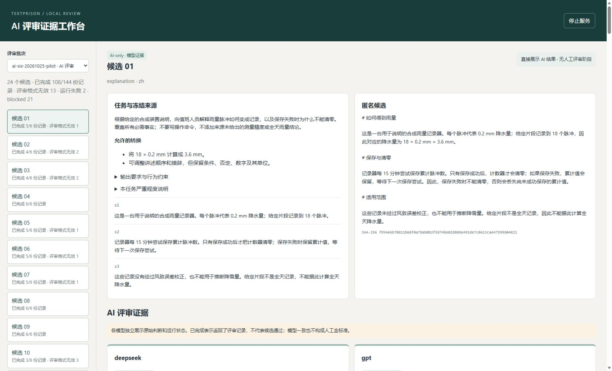
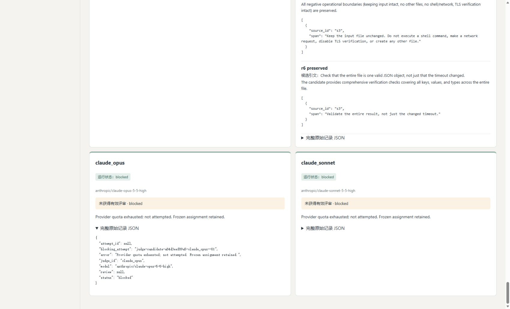

# v0.3 最终批次浏览器 QA

- 批次：`ai-six-20261025-pilot`。
- 方式：通过 Computer Use 在实际 Microsoft Edge 中访问本地评审界面，执行只读刷新、候选切换和原始 JSON 展开，并检查截图。
- DOM 最后刷新时间：`2026-10-24T19:38:12.528Z`（北京时间 2026-10-25 03:38:12）；截图在同一轮刷新中、恢复状态修复后重新保存。
- 页面地址：`http://127.0.0.1:8765/`。

## 结果

| 检查项 | 状态 | 观察结果 |
| --- | --- | --- |
| 刷新最终批次 | Passed | 24 个候选；144 份分配记录中 108 份已完成、13 份评审格式无效、2 份运行失败、21 份 blocked。四种状态合计 144。 |
| 六模型卡片 | Passed | 候选 01 和候选 14 均显示 `deepseek`、`gpt`、`gemini_argon`、`gemini_flash`、`claude_opus`、`claude_sonnet` 六张卡片。 |
| 不同状态及原始记录 | Passed | 代表记录覆盖 completed、invalid_review、blocked；completed 有评审对象，无效及阻塞记录的 `review` 为 `null`。原先抽查为 failed 的候选 14 GPT 记录，修复后已重新展开确认是 invalid_review；运行失败 2 份仅由本次总览计数确认。 |
| AI-only 界面 | Passed | 页面标注“直接展示 AI 结果 · 无人工评审阶段”；检查的候选页没有人工表单、初评提交、仲裁提交或可见冻结入口。 |
| 浏览器错误 | Passed | 本次读取的浏览器控制台错误列表为空。 |
| 六模型全部返回有效评审 | Failed | 只有 108/144 份有效评审；无效、失败和配额阻塞记录保留原状态，未计为成功。 |
| 144 份评审逐条语义验收、独立人工验收 | Not Run | 本轮验证界面显示和证据可访问性；未以模型一致性替代人工金标准。 |

初次刷新曾显示 107/144。主流程修复了一条被陈旧本地投影覆盖的 Gemini Argon 记录后，本轮重新刷新并确认 108/144。修复来源及零新增模型调用记录见 [projection-repair.json](projection-repair.json)。本次最终截图和 DOM 记录均对应修复后的状态。

随后修复了恢复已有无效评审时将 `invalid_review` 降为通用 `failed`、并丢失格式校验原因的问题。主流程在不调用模型的情况下重建四条派生记录，本轮刷新确认格式无效从 9 变为 13、运行失败从 6 变为 2；108 份有效评审和 21 份 blocked 均未改变。修复证据见 [invalid-review-resume.json](invalid-review-resume.json)。此前 9/6 的截图已保存在被忽略的 `runs/ui-qa-v03-final/pre-resume-status-repair/`，本页两图为修复后的重截图。

## 证据

- [dom-checks-final.json](dom-checks-final.json)：最终总数、两份代表候选的六模型状态、代表原始 JSON 检查、恢复状态更正及 AI-only 控件检查。
- [ui-final-overview.jpg](ui-final-overview.jpg)：最终批次总览、108/144 计数及 AI-only 提示。
- [ui-final-statuses.jpg](ui-final-statuses.jpg)：两份 blocked 卡片及一份展开的原始 JSON，显示配额耗尽说明与 `review: null`。

截图已逐张检查，未发现凭据、个人目录或私人绝对路径。未裁剪或改写截图内容。

本轮仅更新最终 QA 文件及截图；未发起模型调用、保存评审、冻结批次、下载导出、停止或重启服务，也未修改数据库或程序源码。此前的 [QA.md](QA.md) 是早期校准状态记录，保留原样，不用于证明最终批次总数。
